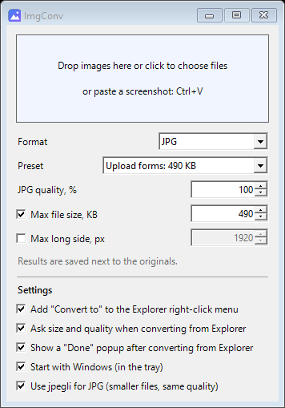
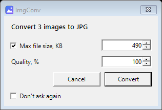
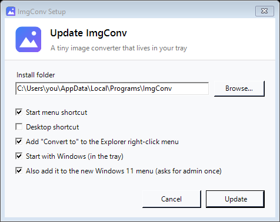

# ImgConv

**A tiny Windows tray app that does one thing: converts images to another format and squeezes them to the file size you need.**

PNG → JPG, WebP/HEIC → JPG, "make this photo under 500 KB" — drop the file in, done. No accounts, no ads, no uploading your photos to a random website, no 200 MB Electron app.



## Why

Every form on the internet wants something different: "JPG only", "max 2 MB", "max 300 KB". Every time, the same routine — google an online converter, upload a personal photo to who-knows-where, wait, download, find out it's still too big, repeat. ImgConv lives in the tray and does it locally in about a second.

## Features

- **Convert** to JPG, PNG, BMP, GIF, TIFF.
- **Reads** JPG, PNG, BMP, GIF, TIFF, ICO, plus WebP / HEIC / AVIF through the codecs Windows already has.
- **Target file size** — set "no larger than N KB" and ImgConv finds the best JPG quality that fits. If even quality 30 is too big, it downscales the image instead of turning it into mush.
- **Max long side** in pixels (e.g. 1920).
- **Right-click menu in Explorer** (on by default), **including the new Windows 11 menu** — no "Show more options" needed: *Convert to → JPG / PNG / …* — a small dialog asks the max size and quality (defaults: **490 KB, quality 100**). Select 20 photos → still one dialog. You can turn the dialog off to convert instantly with saved settings.

  
- Drag & drop files or whole folders. Respects EXIF rotation. Transparent PNGs get a white background in JPG.
- Originals are never touched: the result is saved next to the source (`photo.jpg`, `photo (1).jpg`, …).

## Lightweight on purpose

| | |
|---|---|
| Installer | ~300 KB |
| Program | ~80 KB `.exe` (+ 140 KB menu DLL for Windows 11) |
| RAM while idle in tray | ~4 MB working set |
| CPU while idle | 0 — no timers, no polling, no update checks |
| Dependencies | none — uses .NET Framework 4, built into every Windows 10/11 |
| Admin rights | not needed (one UAC prompt only if you want the Windows 11 menu, see below) |
| Network | never touches it |

## Install

1. Download **`ImgConv-Setup.exe`** from [Releases](../../releases).
2. Run it, pick the options, click **Install**.



It installs to `%LOCALAPPDATA%\Programs\ImgConv` and shows up in *Settings → Apps*, where you can uninstall it (removes everything: files, shortcuts, menu entry, autostart, settings).

> Windows SmartScreen may warn about an unknown publisher because the exe isn't code-signed. Click *More info → Run anyway*, or build it yourself from source (below).

Silent install: `ImgConv-Setup.exe /S`

### About the Windows 11 menu

Windows 11 only lets **packaged** apps into its new right-click menu. ImgConv ships a tiny signed MSIX package (it holds nothing but the menu registration; the app stays a normal folder). The package is signed with a self-signed certificate, so the installer asks for admin **once** to add that certificate to *Trusted People*. Say no, and "Convert to" is still available under *Show more options*.

## Usage

- **Click the tray icon** → window. Drop photos in, or click to pick files. Settings (Explorer menu, the size/quality dialog, autostart) are at the bottom of the window.
- **Right-click photos in Explorer** → *Convert to* → format.

Command line: `ImgConv.exe /to jpg "C:\path\photo.png"` — converts using saved settings and exits.

## Build from source

```powershell
powershell -ExecutionPolicy Bypass -File build.ps1
```

- The app and installer build with the C# compiler that ships with Windows — nothing to install.
- The Windows 11 menu additionally needs **Visual Studio Build Tools (C++)** and the **Windows SDK**. Without them the script builds everything else and skips the menu. On first run it creates a self-signed certificate `CN=ImgConv` in your personal certificate store to sign the package (the private key stays on your PC).

Source: [`ImgConv.cs`](ImgConv.cs) (the app), [`Setup.cs`](Setup.cs) (the installer), [`menu/`](menu) (Windows 11 menu DLL + package manifest).

## Limitations

- Can't *save* WebP/HEIC/AVIF — Windows has no built-in encoder for them (reading works).
- Size limit for PNG/GIF/BMP/TIFF works only by downscaling, since they're lossless.
- Animated GIFs: only the first frame is kept.
- The Windows 11 menu entry is x64 only (on ARM PCs use *Show more options*).

## License

MIT
