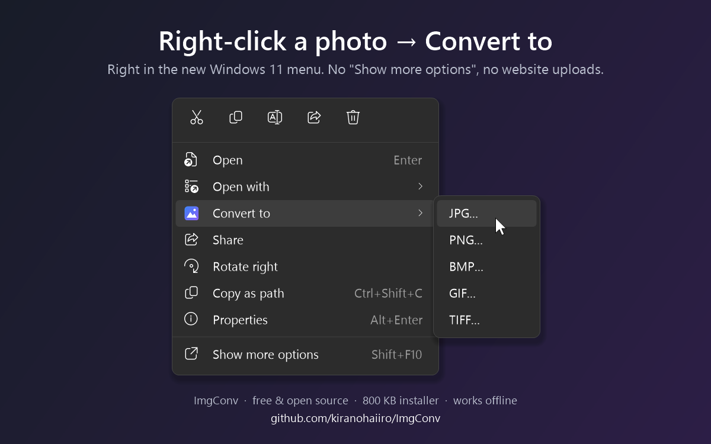
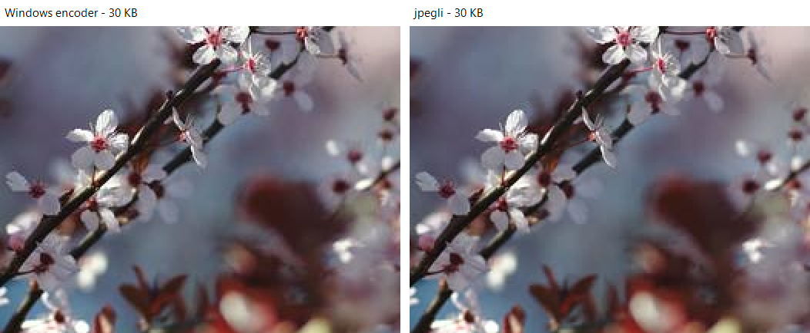
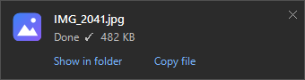

# ImgConv



**A tiny Windows tray app that does one thing: converts images to another format and squeezes them to the file size you need.**

PNG → JPG, WebP/HEIC → JPG, "make this photo under 500 KB" — drop the file in, done. No accounts, no ads, no uploading your photos to a random website, no 200 MB Electron app.


## Why

Every form on the internet wants something different: "JPG only", "max 2 MB", "max 300 KB". Every time, the same routine — google an online converter, upload a personal photo to who-knows-where, wait, download, find out it's still too big, repeat. ImgConv lives in the tray and does it locally in about a second.

## Features

- **Convert** to JPG, PNG, BMP, GIF, TIFF.
- **Reads** JPG, PNG, BMP, GIF, TIFF, ICO, **JPEG XL**, plus WebP / HEIC / AVIF through the codecs Windows already has. JPEG XL works out of the box — no Microsoft Store extension needed.
- **jpegli** — JPGs are encoded with Google's [jpegli](https://github.com/google/jpegli): same size, visibly cleaner, or same quality, ~10% smaller. Can be turned off in settings.
- **Target file size** — set "no larger than N KB" and ImgConv finds the best JPG quality that fits. If even quality 30 is too big, it downscales the image instead of turning it into mush.

  

  *Same photo squeezed to 30 KB (crop, 2× zoom). Left: the encoder built into Windows — blocky background. Right: jpegli.*
- **Max long side** in pixels (e.g. 1920).
- **Right-click menu in Explorer** (on by default), **including the new Windows 11 menu** — no "Show more options" needed: *Convert to → JPG / PNG / …* — a small dialog asks the max size and quality (defaults: **490 KB, quality 100**). Select 20 photos → still one dialog. You can turn the dialog off to convert instantly with saved settings.

  
- **Presets** for common limits: upload forms (490 KB), small (200 KB), email (2 MB), Discord (10 MB), marketplaces like eBay (1600 px, 1 MB).
- **"Done" popup** after a right-click conversion, with *Show in folder* and *Copy file*: paste the result straight into a chat, an email or an upload form.

  
- **Paste a screenshot** (Ctrl+V in the window): it's converted to `Pictures\ImgConv` under your size limit and copied back as a file, ready to paste anywhere.
- **Removes location and camera data.** Phone photos carry GPS coordinates in EXIF; ImgConv's output never does.
- Drag & drop files or whole folders. Respects EXIF rotation. Transparent PNGs get a white background in JPG.
- Originals are never touched: the result is saved next to the source (`photo.jpg`, `photo (1).jpg`, …).

## How is this different from…

Plenty of great tools convert images. If one of these fits you better, use it:

| Tool | Best at |
|---|---|
| **XnConvert** | Batch pipelines: 80+ actions (filters, watermarks, resizing) and hundreds of formats |
| **PowerToys Image Resizer** | Resizing to fixed dimensions, as part of Microsoft's PowerToys suite |
| **FileConverter** | Right-click conversion of video, audio *and* images (ffmpeg + ImageMagick) |
| **Squoosh, Caesium** | Fine-tuning compression by eye, with a before/after preview |
| **ImgConv** | One thing: right-click → the file already fits "under N KB" at the best quality that fits. ~800 KB, offline, ~4 MB RAM |

The gap ImgConv fills is the upload-form case: you don't want to pick a quality or open an app, you just need a file the site will accept.

## Lightweight on purpose

| | |
|---|---|
| Installer | ~800 KB |
| Program | ~80 KB `.exe` + 1.4 MB codecs DLL (loaded only while converting) + 140 KB Windows 11 menu DLL |
| RAM while idle in tray | ~4 MB working set |
| CPU while idle | 0 — no timers, no polling, no update checks |
| Dependencies | none — uses .NET Framework 4, built into every Windows 10/11 |
| Admin rights | not needed (one UAC prompt only if you want the Windows 11 menu, see below) |
| Network | never touches it |

## Install

1. Download **`ImgConv-Setup.exe`** from [Releases](../../releases).
2. Run it, pick the options, click **Install**.


It installs to `%LOCALAPPDATA%\Programs\ImgConv` and shows up in *Settings → Apps*, where you can uninstall it (removes everything: files, shortcuts, menu entry, autostart, settings).

> Windows SmartScreen may warn about an unknown publisher because the exe isn't code-signed yet (see [CODE_SIGNING.md](CODE_SIGNING.md)). Click *More info → Run anyway*, or build it yourself from source (below). Every release is also built on [GitHub Actions](../../actions) from this code.

Silent install: `ImgConv-Setup.exe /S` (no prompts at all; the Windows 11 menu is added silently only if its certificate is already trusted, otherwise the classic menu is used).

### About the Windows 11 menu

Windows 11 only lets **packaged** apps into its new right-click menu. ImgConv ships a tiny signed MSIX package (it holds nothing but the menu registration; the app stays a normal folder). The package is signed with a self-signed certificate, so the installer asks for admin **once** to add that certificate to *Trusted People*. Say no, and "Convert to" is still available under *Show more options*.

## Usage

- **Click the tray icon** → window. Drop photos in, click to pick files, or press Ctrl+V to paste a screenshot. Settings (Explorer menu, the size/quality dialog, the "Done" popup, autostart) are at the bottom of the window.
- **Right-click photos in Explorer** → *Convert to* → format.

Command line: `ImgConv.exe /to jpg "C:\path\photo.png"` — converts using saved settings and exits.

## Build from source

```powershell
powershell -ExecutionPolicy Bypass -File build.ps1
```

- The app and installer build with the C# compiler that ships with Windows — nothing to install.
- jpegli and JPEG XL come from [libjxl](https://github.com/libjxl/libjxl). Build it once with `build-codecs.ps1` (downloads libjxl v0.11.1 into `%LOCALAPPDATA%\ImgConvBuild`, needs Visual Studio Build Tools); after that `build.ps1` includes `ImgConvCodecs.dll`. Without it the app still works, using the Windows JPEG encoder.
- The Windows 11 menu additionally needs **Visual Studio Build Tools (C++)** and the **Windows SDK**. Without them the script builds everything else and skips the menu. On first run it creates a self-signed certificate `CN=ImgConv` in your personal certificate store to sign the package (the private key stays on your PC).

Source: [`ImgConv.cs`](ImgConv.cs) (the app), [`Setup.cs`](Setup.cs) (the installer), [`menu/`](menu) (Windows 11 menu DLL + package manifest), [`codecs/`](codecs) (jpegli + JPEG XL wrapper).

## Contributing and forking

The project is documented so you (or your AI assistant) can change it cheaply:

- [AGENTS.md](AGENTS.md): principles, build steps, gotchas and testing, written for AI coding assistants and humans alike.
- [docs/ARCHITECTURE.md](docs/ARCHITECTURE.md): how the pieces fit together.
- [docs/DECISIONS.md](docs/DECISIONS.md): why things are the way they are, including what was tried and rejected.
- [docs/research/](docs/research): measurements behind the decisions.
- [CHANGELOG.md](CHANGELOG.md): what changed in each version.

## Limitations

- Can't *save* WebP/HEIC/AVIF/JPEG XL yet (reading works).
- Size limit for PNG/GIF/BMP/TIFF works only by downscaling, since they're lossless.
- Animated GIFs: only the first frame is kept.
- The Windows 11 menu entry is x64 only (on ARM PCs use *Show more options*).

## License

MIT. `ImgConvCodecs.dll` bundles libjxl, Highway, Brotli and skcms under their own permissive licenses — see [THIRD-PARTY-NOTICES.txt](THIRD-PARTY-NOTICES.txt).
